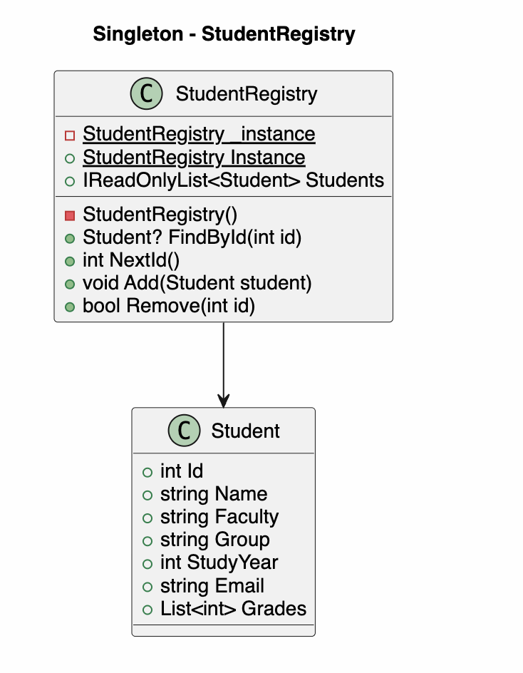
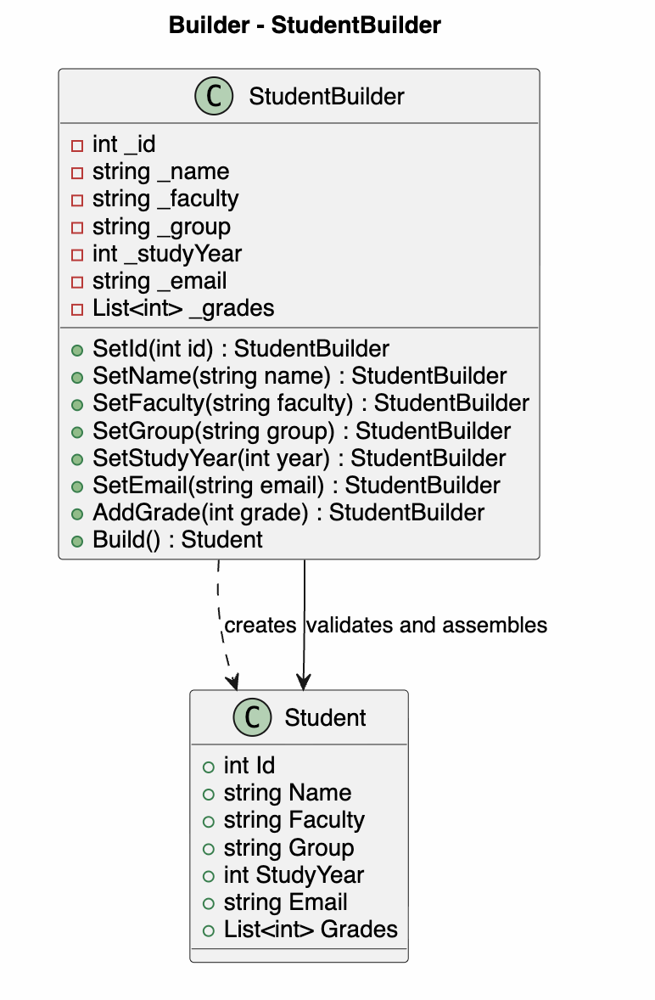
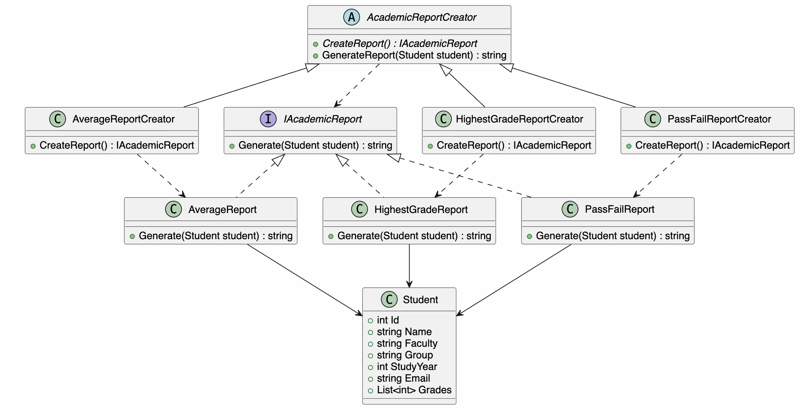

# Technical University of Moldova
**Faculty of Computers, Informatics and Microelectronics (FCIM)**

# Laboratory Work No. 1
## Student Grade Management System
### Implementation of Creational Design Patterns in C#

**Student:** Tataroi Bianca-Andreea  
**Academic Group:** FAF-242  
**Discipline:** TMPS  
**Patterns Implemented:** Singleton, Builder, Factory Method

---

## 1. Objective

Extend the Student Grade Management System developed in Laboratory Work No. 0 by implementing three creational design patterns: **Singleton**, **Builder**, and **Factory Method**. Preserve the SOLID-based structure where practical and demonstrate the patterns through real application features.

## 2. Project Description

The project is a .NET 10 console application for managing student profiles and grades. It can:

1. Display all students.
2. Add students with complete profiles (name, ID, faculty, group, study year, and email).
3. Assign grades from 1 to 10.
4. View student profiles.
5. Update student profile information.
6. Delete students.
7. Generate academic reports: average grade, highest grade, and pass/fail result.

All data is stored **in memory** and is reset when the application restarts. The sample student emails are placeholders and not real contact information.

## 3. Project Structure

| File | Responsibility |
| --- | --- |
| `Program.cs` | Console menu, user input and workflow |
| `GradeSystem.cs` | Student model, grade calculators and `GradeManager` |
| `StudentRegistry.cs` | Singleton student registry |
| `StudentBuilder.cs` | Builder for creating complete student profiles |
| `AcademicReports.cs` | Academic report products and Factory Method creators |
| `StudentGrades.csproj` | .NET 10 project configuration |

## 4. Implemented Design Patterns

### 4.1 Singleton — StudentRegistry

**Problem:** Multiple independent student lists could lead to inconsistent student data within the application.

**Solution:** `StudentRegistry` exposes a shared `Instance` property and has a private constructor. The registry provides methods such as `Add`, `FindById`, `Remove`, and `NextId`. Student addition, lookup, grade assignment, editing, deletion and reporting all use this shared registry.



The `Lazy<StudentRegistry>` implementation initializes the instance only when first requested and is thread-safe for instance creation. This example does not implement concurrent synchronization for changes to the student collection.

### 4.2 Builder — StudentBuilder

**Problem:** Student profiles contain several required fields and may include grades. Passing all values to a constructor can become difficult to read and validate.

**Solution:** `StudentBuilder` provides a fluent, step-by-step creation API. The `Build()` method validates required fields, study year and email before returning a `Student`.



The new-student menu operation uses this builder to create real records.

### 4.3 Factory Method — Academic Reports

**Problem:** The application needs different academic report types without placing their construction logic inside the report generation workflow.

**Solution:** `AcademicReportCreator` declares the abstract `CreateReport()` factory method. Three concrete creators override it:



| Creator | Report |
| --- | --- |
| `AverageReportCreator` | `AverageReport` |
| `HighestGradeReportCreator` | `HighestGradeReport` |
| `PassFailReportCreator` | `PassFailReport` |

All reports implement `IAcademicReport`. The base creator's `GenerateReport()` method uses the object returned by `CreateReport()`.

For this laboratory demonstration, **PASS** means that the average grade is at least 5. This is an application rule, not a claim about an official university grading policy.


## 5. Relationship to Lab 0 (SOLID)

The Lab 0 code demonstrated these principles, which remain present in Lab 1:

- **SRP:** `Student` stores profile data, `GradeManager` manages grade operations and report classes format specific academic results.
- **OCP:** Additional implementations of `IGradeCalculator` or `IAcademicReport` can be created without modifying the corresponding consumers. Making an additional report selectable in the console menu still requires wiring its creator there.
- **DIP:** `GradeManager` depends on the `IGradeCalculator` interface instead of a specific calculator class.

Unlike Lab 0, Lab 1 adds new behavior as well as new creation mechanisms: full profiles, update/delete operations, and multiple academic reports.

## 6. Running the Application

Requirements: .NET 10 SDK.

Open a terminal inside the project directory and run:

```bash
dotnet run
```

The menu displays:

```text
=== STUDENT GRADE MANAGEMENT SYSTEM - LAB 1 ===
1. View all students
2. Add new student
3. Add grade
4. View student profile
5. Update student information
6. Delete student
7. Generate academic report
0. Exit
```

## 7. Testing and Expected Results

### Test 1 — Builder and Singleton

1. Choose `2` and enter a valid student profile.
2. Choose `1` and confirm that the new student appears in the list.
3. Choose `4` and enter their ID to view the complete profile.

**Expected:** The builder creates a valid student, and the shared registry stores the record that other menu operations retrieve.

### Test 2 — Grades and Factory Method

1. Choose `3` to assign grades `9` and `7` to a student.
2. Choose `7` and select the average report.
3. Choose `7` again and select the highest-grade report.
4. Choose `7` again and select the pass/fail report.

**Expected values for grades 9 and 7:**

```text
Average grade: 8.00
Highest grade: 9.00
Average: 8.00 | Status: PASS
```

These are expected results from the code, not evidence of a completed runtime test.

### Test 3 — Validation and Update/Delete

- Creating a student with an invalid email must show an error and not add that student.
- Grades outside the range 1–10 must be rejected.
- Editing a student's name or group should be visible on the next profile view.
- Deleting a student requires confirmation and removes the student from the list.
- Reports for students with no grades display a message rather than attempting a calculation.

## 8. Conclusion

In this laboratory, the Student Grade Management System from Lab 0 was extended with Singleton, Builder and Factory Method. Singleton centralizes access to student records, Builder assembles and validates complete profiles, and Factory Method creates different types of academic reports through specialized creators. The application now supports student profile management and multiple report types while retaining the grade-calculation abstractions from the SOLID-based design of Lab 0.
